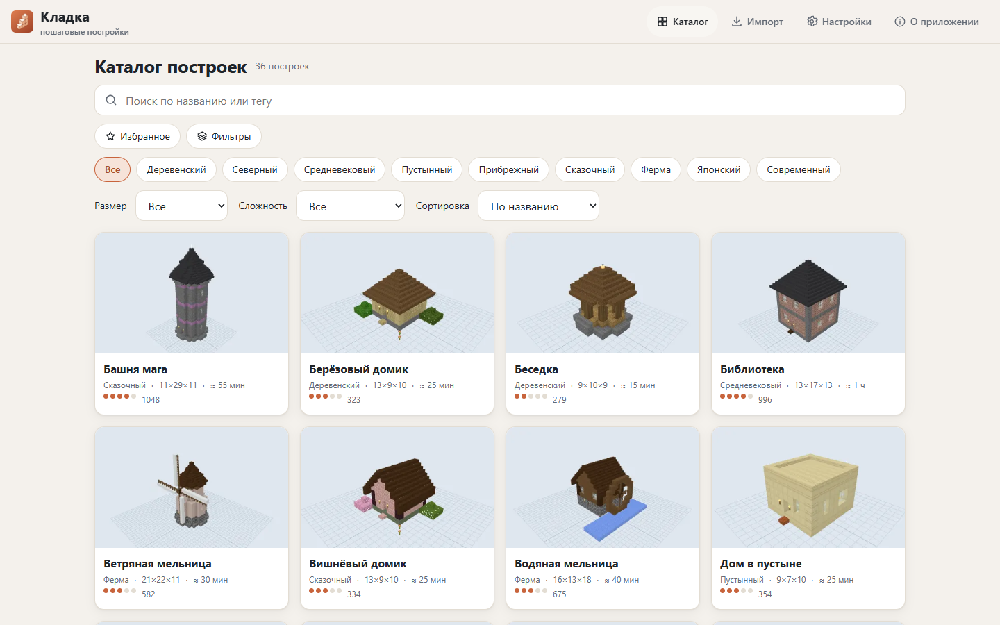

# Kladka — step-by-step builds

[Русская версия → README.md](README.md)

An offline app that shows how to build structures in **Minecraft Java Edition** (26.3) step by step: a 3D model,
"smart" stages (foundation → frame → walls → windows & doors → roof → interior → decor), 2D layer plans with
coordinates, material lists in pieces/stacks/shulker boxes, import and export of `.schem`, `.litematic` and `.nbt`.
Platforms: **Android** (APK for RuStore), **Windows / Linux / macOS** (Tauri), **PWA** (including iPhone).

No ads, purchases, analytics, accounts or servers — everything works without internet.

> NOT AN OFFICIAL MINECRAFT PRODUCT. NOT APPROVED BY OR ASSOCIATED WITH MOJANG OR MICROSOFT.



## Features

- **36 original builds** made by the project's parametric generators (CC0).
- **Step-by-step mode:** stages → layers → steps, highlighted blocks, Back / Next / Step done, saved progress,
  materials per step/layer/stage, 2D layer plan, PNG and PDF export of plans.
- **Free 3D view:** orbit, zoom, section along any axis, "layers up to Y", stage colouring, block-type highlight,
  build animation, screenshot, GIF and WebM.
- **"Shaders" mode:** soft shadows, SSAO (GTAO), bloom, fog, sky, day/sunset/night, three quality levels.
- **Import** of `.schem` (Sponge v1–v3), `.litematic` (multi-region), `.nbt` (structure block) and `.zip` content
  packs. Stages, materials and covers are computed on the device.
- **Export** to `.litematic`, `.schem` v3/v2 and `.nbt` with in-app instructions for opening them in the game.
- **Your own resource pack / client.jar:** load textures from your own game installation; the file is read locally
  and never copied or uploaded.
- Russian and English UI, light/dark themes, text scaling, left-handed layout, keyboard controls.

## Quick start (development)

Requires Node.js ≥ 22 (24 LTS recommended) and pnpm 10.

```bash
pnpm install
```

```bash
pnpm dev
```

| Command                                        | Purpose                                                                                  |
| ---------------------------------------------- | ---------------------------------------------------------------------------------------- |
| `pnpm test`                                    | Unit tests (Vitest)                                                                      |
| `pnpm test:e2e`                                | E2E tests (Playwright); locally with Edge: `KLADKA_BROWSER_CHANNEL=msedge pnpm test:e2e` |
| `pnpm lint` / `pnpm typecheck` / `pnpm format` | Lint, types, formatting                                                                  |
| `pnpm content:build`                           | Generate the built-in content pack                                                       |
| `pnpm render:previews`                         | Render covers (classic + cinematic, 4 angles, thumbnails)                                |
| `pnpm build:web`                               | Build the web/PWA bundle                                                                 |
| `pnpm check:offline`                           | Verify the bundle has no remote URLs                                                     |

## Building the apps

- **Web/PWA:** `pnpm build:web`, deploy `apps/app/dist` to any static HTTPS host.
- **Desktop (Tauri 2):** install Rust and the Tauri system dependencies, then `pnpm --filter @kladka/app tauri build`.
- **Android (Capacitor 8):** JDK 21 + Android SDK; `pnpm build:web`, `pnpm --filter @kladka/app exec cap sync android`,
  then `./gradlew assembleRelease` in `apps/app/android`. Signing: [docs/RUSTORE.md](docs/RUSTORE.md).

GitHub Actions build all of them (`.github/workflows`) and attach the artifacts to the run and to `v*` releases.

## Importing builds and content packs

Open **Import** and pick a `.schem`, `.litematic`, `.nbt` or `.zip` content pack. A content pack is a zip with
`pack.json` plus build files; see [docs/CONTENT.md](docs/CONTENT.md).

## Documentation

[Architecture](docs/ARCHITECTURE.md) · [Formats](docs/FORMATS.md) · [Content](docs/CONTENT.md) ·
[Decisions](docs/DECISIONS.md) · [Legal](docs/LEGAL.md) · [RuStore](docs/RUSTORE.md) ·
[Shader screenshots](docs/SHADER_SCREENSHOTS.md) · [Third-party licenses](THIRD_PARTY_LICENSES.md)

## License

Code: MIT. Built-in builds, covers and icon: CC0 1.0. Minecraft is a trademark of Mojang Synergies AB; this project
is not affiliated with Mojang or Microsoft.
