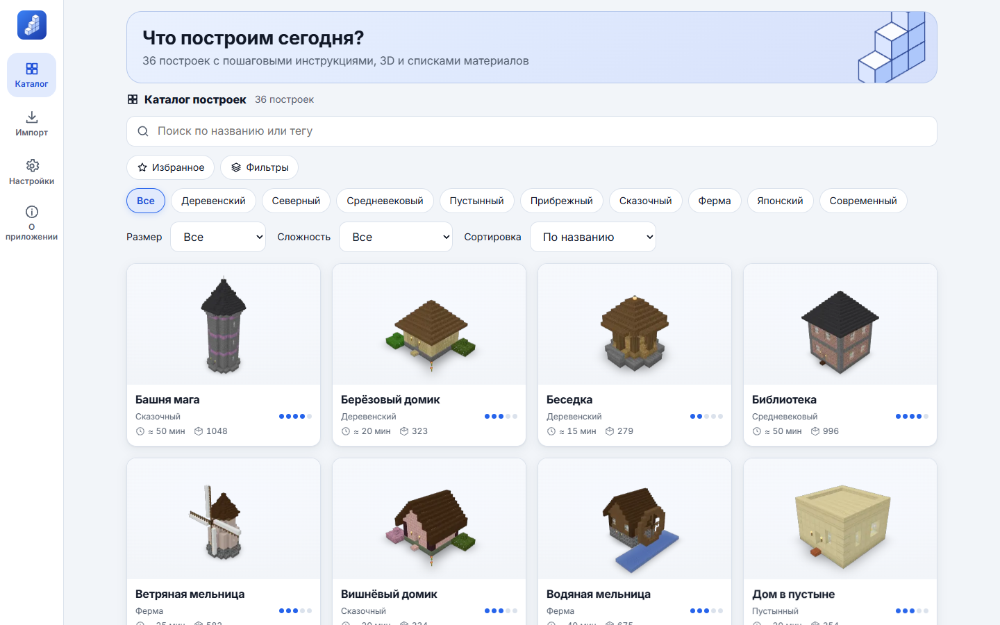
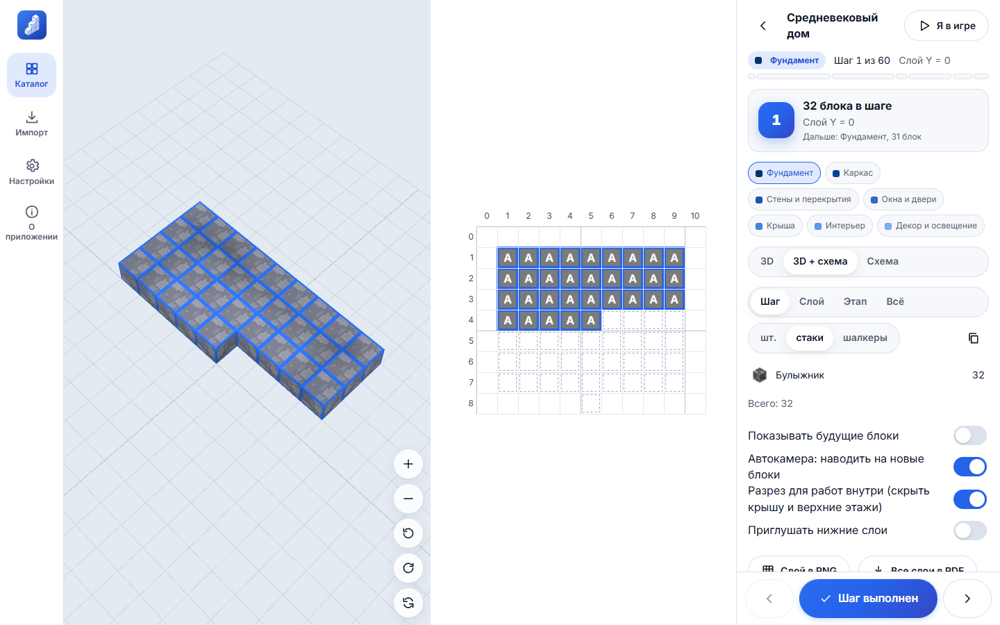
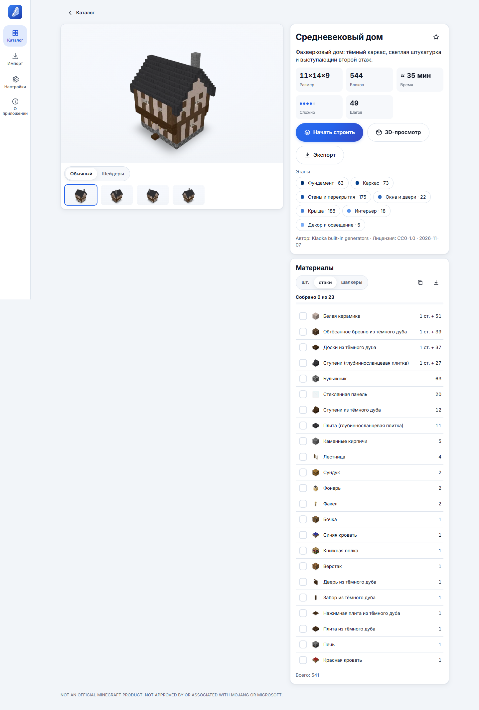
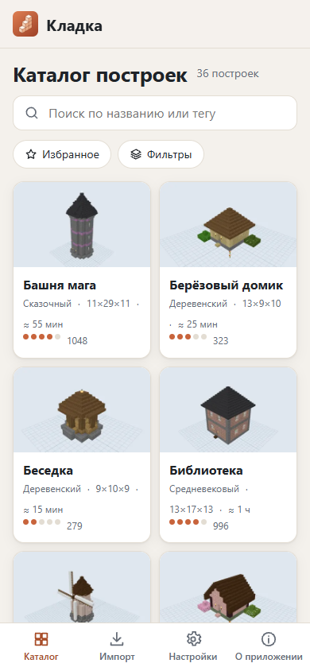

# Кладка — пошаговые постройки

[English version → README.en.md](README.en.md)

Офлайн-приложение, которое показывает, как шаг за шагом построить здание в **Minecraft Java Edition** (26.3):
3D-модель, «умные» этапы (фундамент → каркас → стены → окна и двери → крыша → интерьер → декор), послойные
2D-схемы с координатами, списки материалов в штуках/стаках/шалкерах, импорт и экспорт `.schem`, `.litematic`,
`.nbt`. Платформы: **Android** (APK для RuStore), **Windows / Linux / macOS** (Tauri), **PWA** (в т.ч. iPhone).

Без рекламы, покупок, аналитики, аккаунтов и серверов: всё работает без интернета.

> NOT AN OFFICIAL MINECRAFT PRODUCT. NOT APPROVED BY OR ASSOCIATED WITH MOJANG OR MICROSOFT.



| Пошаговый режим                     | Карточка постройки                  | Телефон                             |
| ----------------------------------- | ----------------------------------- | ----------------------------------- |
|  |  |  |

## Возможности

- **36 оригинальных построек** (домики, коттеджи, фахверк, башни, маяк, мельницы, амбар, ферма, мост, пагода,
  мини-замок, часовня и др.), созданных параметрическими генераторами проекта, лицензия CC0.
- **Пошаговый режим:** этапы → слои → шаги, подсветка блоков шага, «Назад / Далее / Шаг выполнен»,
  автосохранение прогресса, материалы на шаг/слой/этап, 2D-схема слоя, экспорт схем в PNG и PDF.
- **Свободный 3D-просмотр:** вращение, масштаб, срез по любой оси, «слои до Y», раскраска по этапам,
  подсветка типа блока, анимация «вырастания», скриншот, GIF и WebM.
- **Режим «Шейдеры»:** мягкие тени, SSAO (GTAO), bloom, туман, небо, день/закат/ночь, три уровня качества.
- **Импорт** `.schem` (Sponge v1–v3), `.litematic` (в т.ч. многорегионных), `.nbt` (структурный блок) и
  контент-паков `.zip`. Этапы, материалы и обложка считаются прямо на устройстве.
- **Экспорт** в `.litematic`, `.schem` v3/v2 и `.nbt` + инструкция, как открыть файл в игре.
- **Свой ресурспак / client.jar:** можно подключить текстуры из своей установки игры. Файл читается
  локально и никуда не копируется.
- **Режим «Я в игре»:** экран не гаснет, крупный номер шага, схема слоя и материалы шага, огромная кнопка «Шаг
  выполнен» под большой палец (с учётом левши/правши), листание свайпом.
- **Чек-лист материалов:** отмечайте собранные ресурсы галочками, прогресс сохраняется; список можно скопировать
  или отправить («Поделиться»).
- **«Открыть с помощью»:** на Android файлы постройки из Telegram, «Файлов» и «Загрузок» открываются прямо в
  приложении (и через «Поделиться»); в установленной PWA на ПК — двойным щелчком по файлу.
- Русский и английский интерфейс, светлая и тёмная темы, масштаб текста, режим для левшей, управление с клавиатуры.

## Быстрый старт (разработка)

Нужны Node.js ≥ 22 (рекомендуется 24 LTS) и pnpm 10.

```bash
pnpm install
```

```bash
pnpm dev
```

Откройте http://localhost:5173. Полезные команды:

| Команда                                        | Что делает                                                                             |
| ---------------------------------------------- | -------------------------------------------------------------------------------------- |
| `pnpm test`                                    | Unit-тесты (Vitest): NBT, форматы, планировщик, мешер, каталог                         |
| `pnpm test:e2e`                                | E2E-тесты (Playwright). Локально с Edge: `KLADKA_BROWSER_CHANNEL=msedge pnpm test:e2e` |
| `pnpm lint` / `pnpm typecheck` / `pnpm format` | Линтер, типы, форматирование                                                           |
| `pnpm content:build`                           | Сгенерировать встроенный контент-пак (`apps/app/public/packs/core`)                    |
| `pnpm render:previews`                         | Отрендерить обложки (classic + cinematic, 4 ракурса, миниатюры)                        |
| `pnpm build:web`                               | Сборка web/PWA в `apps/app/dist`                                                       |
| `pnpm check:offline`                           | Проверить, что в бандле нет обращений к внешним адресам                                |
| `node tools/licenses.mjs`                      | Аудит лицензий → `THIRD_PARTY_LICENSES.md`                                             |

## Сборка приложений

**Web / PWA:** `pnpm build:web`, затем выложите `apps/app/dist` на любой статический хостинг (HTTPS).
На iPhone: Safari → «Поделиться» → «На экран “Домой”».

**ПК (Tauri 2):** нужны Rust (stable) и системные зависимости Tauri
(Windows: WebView2 + MSVC Build Tools; Linux: `libwebkit2gtk-4.1-dev librsvg2-dev`; macOS: Xcode CLT).

```bash
pnpm --filter @kladka/app tauri build
```

**Android (Capacitor 8):** нужны JDK 21 и Android SDK (Android Studio).

```bash
pnpm build:web
```

```bash
pnpm --filter @kladka/app exec cap sync android
```

```bash
cd apps/app/android && ./gradlew assembleRelease
```

Подпись релиза и публикация — в [docs/RUSTORE.md](docs/RUSTORE.md).

Все три сборки также выполняются в **GitHub Actions** (`.github/workflows`): web + тесты, Tauri для
Windows/Linux/macOS, Android APK (debug и release) и AAB. Артефакты прикрепляются к запуску и к релизу при теге `v*`.

## PWA на GitHub Pages (установка на телефон)

1. Создайте репозиторий на GitHub и отправьте туда код (ветка `main`).
2. В репозитории: **Settings → Pages → Build and deployment → Source: GitHub Actions**.
3. Workflow `.github/workflows/pages.yml` соберёт PWA и опубликует её по адресу
   `https://<ваш-ник>.github.io/<репозиторий>/` (ссылка появится во вкладке Actions).
4. На телефоне откройте ссылку → меню браузера → «Добавить на главный экран» / «Установить приложение».
   После первого открытия приложение работает без интернета.

## Как импортировать постройки

1. Откройте «Импорт» и выберите файл `.schem`, `.litematic` или `.nbt` (или перетащите его в окно).
2. Приложение само разобьёт постройку на этапы и шаги, посчитает материалы и нарисует обложку.
3. Постройка появится в каталоге (раздел «Импорт» в фильтрах стилей). Её можно пройти по шагам и экспортировать.

Старые файлы MCEdit `.schematic` (до 1.13) не поддерживаются — пересохраните их в `.schem` (WorldEdit) или `.litematic`.

## Как добавить свой контент-пак

Контент-пак — это `.zip` с файлом `pack.json` и файлами построек (`.kbuild`, `.schem`, `.litematic`, `.nbt`).
Формат описан в [docs/CONTENT.md](docs/CONTENT.md). Чтобы добавить постройки во встроенный пак, напишите
генератор в `packages/content/src/generators`, добавьте запись в `catalog.ts` и выполните
`pnpm content:build && pnpm render:previews`.

## Документация

- [docs/ARCHITECTURE.md](docs/ARCHITECTURE.md) — устройство монорепозитория, «умные этапы», рендеринг
- [docs/FORMATS.md](docs/FORMATS.md) — поддержка форматов и проверка совместимости
- [docs/CONTENT.md](docs/CONTENT.md) — генераторы и контент-паки
- [docs/DECISIONS.md](docs/DECISIONS.md) — принятые решения и их обоснование
- [docs/LEGAL.md](docs/LEGAL.md) — что можно и нельзя, текстуры и права
- [docs/RUSTORE.md](docs/RUSTORE.md) — подготовка к публикации в RuStore
- [docs/SHADER_SCREENSHOTS.md](docs/SHADER_SCREENSHOTS.md) — «настоящие» шейдерные скриншоты (Iris/Chunky)
- [THIRD_PARTY_LICENSES.md](THIRD_PARTY_LICENSES.md) — лицензии зависимостей

## Лицензия

Код — MIT ([LICENSE](LICENSE)). Встроенные постройки, обложки и иконка — CC0 1.0.
Minecraft — товарный знак Mojang Synergies AB; проект с Mojang и Microsoft не связан.
